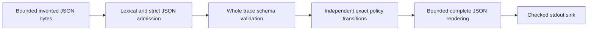

# Rate-limit admission lab

Compare token-bucket and fixed-window admission using invented timestamps, costs and identity labels. Each event produces both decisions, exact state and reconciled attempt/cost totals. This is an offline learning model: admission does not establish authentication, authorization, delivery, execution or committed effects.

## Run a demo

Runtime requires only Python's standard library. Verified locally on Windows CPython 3.13.7; other runtimes and Linux are unverified. From this repository directory:

```powershell
python scripts/make_demo.py demos
python -m rate_admission demos/adjacent-windows.json
```

The helper creates ten invented inputs in a fresh directory and refuses existing directories. Ordinary file failures can leave partial files in that fresh directory; it never overwrites an existing demo directory. The CLI prints one compact JSON report. A valid trace exits **0**, including policy denials; an error exits **2**, prints a closed JSON diagnostic on stderr and produces no successful report. `python -m rate_admission --help` prints usage.

For capacity/quota 2, refill 2 units per 1,000,000 microseconds and windows of that same length, the adjacent-window demo shows:

| Event time (microseconds) | Cost | Token bucket | Fixed window |
| --- | --- | --- | --- |
| 999,999 | 1 | admit | admit |
| 999,999 | 1 | admit | admit |
| 1,000,000 | 1 | deny | admit |
| 1,000,000 | 1 | deny | admit |

The window resets at equality; the bucket has regained only 2/1,000,000 cost units. Both policies use the same average rate/capacity in this example, but their boundary behavior differs. This is a demonstration, not a general ranking.

## Input and model

Example complete input:

```json
{"schema_version":1,"policies":{"token_bucket":{"capacity":2,"refill_units":2,"period_us":1000000},"fixed_window":{"quota":2,"window_us":1000000}},"events":[{"event_id":"lab-event-0000","identity":"lab-client-0001","time_us":0,"cost":2},{"event_id":"lab-event-0001","identity":"lab-client-0001","time_us":500000,"cost":1}]}
```

All fields are required, unknown fields rejected. Event IDs are unique ASCII `lab-event-NNNN`; identity labels are `lab-client-NNNN`. Equal labels declare shared state; different labels get independent state. Labels do not authenticate callers. Timestamps are nonnegative invented relative microseconds, globally nondecreasing; equal-time events use array order. A backwards or malformed late event rejects the whole input before any transitions/report. Empty traces are valid.

The token bucket starts full at each identity's first observation. With capacity B, refill R per P microseconds, scaled integer credit C represents **C/P cost units**. Before an event, refill `min(B*P,C+elapsed_us*R)`; admit only if the whole `cost*P` fits, then debit. Fractional credit survives exactly, surplus above capacity is discarded. Reports keep unreduced numerators/denominator P; these values are cost units, not time durations.

Fixed windows are anchored at relative zero and cover `[kW,(k+1)W)`. Reset spent cost before an event in a new index, including exact boundary equality and skipped windows. Only admitted cost is charged. Oversize costs are valid denials but still advance/refill/reset state before denial. Final identity state includes its own last event time; inactive identities are never silently advanced to global trace end.

Each policy has independent state and reports every input event, including denials. Global/per-identity attempts and attempted/admitted/denied cost reconcile separately. `effects: unmodeled` is explicit. This chosen fixed-window accounting differs from the inspected `limits` implementation; this single bucket is not RFC 2697's full color marker. See [research](RESEARCH.md) and [frozen contract](PLAN.md).

## Architecture and bounds



`admission.py` gates bytes/encoding/depth/numeric text/strings/containers. `core.py` validates an immutable trace, models the two policies and renders it. `__main__.py` reads a checked regular file and controls output/errors. `tests/support.py` holds frozen-fixture verification and a separate Fraction oracle; `scripts/verify.py` reproduces checks/mutations/demos in owned fresh folders.

| Bound | Fixed limit |
| --- | --- |
| Raw input | 65,536 bytes |
| Nesting / encoded string body / integer spelling | 8 containers / 128 bytes / 16 characters |
| Arrays / total object keys | 256 items / 2,048 keys, checked after decoding |
| Events / distinct identities | 256 / 16 |
| Cost, capacity, quota, refill units | actual integers 1–1,000 |
| Period/window | actual integers 1–1,000,000 microseconds |
| Timestamp | actual integer 0–3,600,000,000 microseconds |
| Serialized report | 262,144 UTF-8 bytes; never truncated |

Reject booleans as integer fields, floats, nonfinite values, duplicate decoded keys, invalid UTF-8/lone surrogates and unknown schema versions. Container limits are postdecode admission checks, not preallocation guarantees. Input byte/depth/string/numeric gates apply before successful decoding. Limits bound workload; they do not impose hard CPU/RSS/I/O deadlines or isolate filesystem races. Stable regular files can change between checks/open; same-user compromise is outside the boundary. Reports intentionally reveal permitted synthetic metadata; this is not redaction. Output can be partial if a sink fails. Use invented data only; no clocks, HTTP, traffic, real quotas, persistence, concurrency, distributed enforcement or effects are modeled.

## Verification and learning

```powershell
python -m unittest discover -s tests -v
python -O -m unittest discover -s tests -v
python scripts/verify.py docs/verification/my-fresh-run
```

The verifier additionally requires installed Bandit 1.9.4 (development-only, pinned in requirements-dev.txt). No dependencies were installed during this work. It refuses an existing evidence directory, executes only owned reviewed code, creates isolated mutation copies and records exact source/fixture hashes. Read it before running. Evidence retention is intentional; no automatic cleanup of old results.

Local results: **32 tests pass normally and optimized**, ten frozen hand cases, 108 separate rational-oracle policy sets, ten CLI demos, four detected assertion failures from semantic mutations with restored copies/unchanged original, zero remaining Bandit findings/errors and actual-change ECC self-review. A maximum-cardinality trace was 23,713 input bytes and 118,822 report bytes. Finite tests are not formal proof, throughput or security certification. See [verification](VERIFICATION.md) and [review](REVIEW.md) for exact commands, exclusions, resolved issues and limitations.

Prepared GitHub checks/CodeQL use immutable previously verified action SHAs, minimum permissions and checkout persist-credentials false. They target a future `main` branch. No remote exists; hosted CI, CodeQL, Linux, protections/security eligibility, dependency update services and secret-scanning features have not been run/configured. Bandit has six narrowly justified fixed-subprocess exceptions in tests/verifier, none in application code; no broad skip list. Development transitive dependencies are not hash-locked.

Learn why fractional refill survives a denied event, why window anchor/accounting rules matter, and why admission is not evidence of completed work. [LEARNING.md](LEARNING.md) includes an optional boundary exercise.

MIT license. Original model/tests; bounded parsing and file/sink patterns adapted from Jake's MIT structured-log-redaction-lab at d57bc0f. No upstream library implementation copied; inspected sources/obligations are documented in RESEARCH.md. AI assistance: Codex implemented, verified and self-reviewed; local Ollama supplied two small raw drafts which were corrected. Raw drafts remain ignored/local. No remote worker inference or paid fallback. Local implementation only; publication/deployment needs Jake's separate approval.

## Publication status

See [publication review](PUBLICATION.md) for the October 5 source snapshot, fresh local checks, evidence boundaries and current hosted-check distinction.
